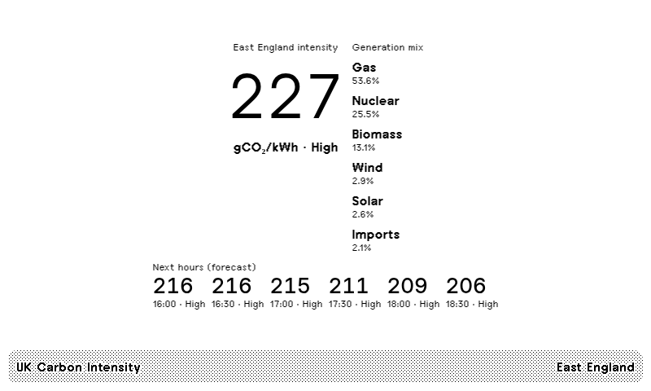

# UK Carbon Intensity

TRMNL e-ink private plugin for live UK electricity carbon intensity: current gCO₂/kWh, index band, short forecast, and generation mix. No API key.



## Data source

Polls the free [National Grid ESO Carbon Intensity API](https://api.carbonintensity.org.uk) ([carbonintensity.org.uk](https://carbonintensity.org.uk)). Data © National Grid ESO / carbonintensity.org.uk.

- `GET https://api.carbonintensity.org.uk/intensity`
- `GET https://api.carbonintensity.org.uk/generation`
- `GET https://api.carbonintensity.org.uk/intensity/{from}/fw24h`
- Optional regional: `GET https://api.carbonintensity.org.uk/regional/postcode/{outcode}` (for example `IP1`)

An outward code must be a valid UK outcode that includes the sector digit, such as `IP1`. Leave it blank for national figures. The grid updates every half hour, so the refresh floor is 30 minutes.

## Shows

- Current national or regional intensity in gCO₂/kWh, plus the index band
- The next few half-hour forecast slots
- Generation mix percent (gas, wind, nuclear, solar, imports, and more)

Layouts: full, half horizontal, half vertical, and quadrant.

## Install

**TRMNL import ZIP**

1. Zip the contents of `src/` flat so the archive root contains `settings.yml`, the `*.liquid` layouts, and `transform.py`.
2. On TRMNL: Plugins → Private Plugin → Import, and upload that zip.
3. Optionally set a postcode outward code (for example `IP1` for Ipswich).

**`trmnlp`**

```sh
trmnlp login
trmnlp serve
# open http://localhost:4567/full
trmnlp push
```

Publish as a Recipe from the plugin settings when you are ready (the Chef linter runs first).

## License

[MIT](LICENSE) © 2026 Alex Baldry.
